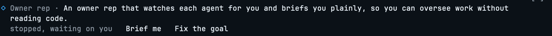

# Owner rep

A Claude Code mod that oversees a coding agent on behalf of the person who owns the work,
and tells them in plain words what is really going on and what to do about it.

It was built in one day, on 13 October 2026, by directing a Claude Code agent from a written
objective to an installed, working tool, with every part proven on screen before the next
was started. No code was written by hand.



## The problem

Someone who runs a business on software that AI agents build, and does not read code,
cannot tell when an agent is cutting a corner, heading the wrong way, or calling work
finished that is not. The agent's own report is the only account they get, and it is the one
account that cannot be trusted. They need a representative on their side of the table: one
that reads everything the agent did, takes none of it on the agent's word, and reports back
briefly.

## What it does

One row above the prompt, always there, in the same shape as Claude Code's built-in
"You should know" notes:

- the result the owner wants, in the rep's own words, worked out from the owner's messages,
  not copied from them;
- what the agent is doing right now, and how many helpers it has running;
- a mark when the session is worth a look: the agent has stopped, is asking something, or a
  plan is waiting for a yes.

Without pressing anything, a **watch** runs at every stop and every eighth model request. It
reads the same conversation the agent is working from and stays silent unless there is
something with a cost to the owner: work dropped or shrunk, a claim not shown, a test never
run, the easy option taken in place of the right one. Then one "Heads up" line appears.

On a press, a **briefing** card: where the work really stands, what the agent's message means,
what was left out, what should happen next, and the message to send to the agent, written and
ready, with one line saying what it will make the agent do. The message goes into the prompt
box; nothing is sent until the owner presses Enter.


On a second press, a **check**: a separate, read-only Claude Code run that reads the session's
full record through agentsview, opens the real files and runs the project's own tests, then
rewrites the card with each claim marked holds, false or not shown.

## How it decides

The rep measures against one plain sentence, the result the owner wants and why, and five
expectations that hold for every job: the whole result is delivered; it is shown to work, not
said to work; no known problem is left behind; nothing was added that the result does not
need; and it was done the way that is best for the result, not the way that was easiest for
the agent. It applies these without reciting them. The owner's messages are evidence of what
they want, weighted by kind: their reasons and complaints first, their instructions next, and
their "yes" to an agent's idea last, checked like any other agent claim. Nothing in a session
except the owner's own messages can give it orders.

## Decisions made along the way

Most of the work was judgment, not code. The ones that shaped the tool:

- **Build on a mechanism that already works.** Claude Code's "You should know" feature reads
  a cached copy of the agent's conversation with a fresh instance of the model, so it costs
  little and never slows the agent. The rep uses the same mechanism with a different brief.
  Its independence comes from its instructions and, for the check step, from reading outside
  the conversation.
- **No side panel.** Everything lives in the strip above the prompt, drawn in the shape the
  owner already knows, because a clean row that is always there beats a panel that must be
  opened. The strip is shared with other mods, so the rep passes it along, yields its buttons
  while another note is up, and never repeats a note the other mod already showed.
- **Digits, not letters.** From the prompt box only a bare digit presses a band button. A
  first version used letters; the first live press showed it, and every button became a digit.
- **Fix the goal through the prompt box.** The owner edits the rep's sentence in their own
  prompt and presses Enter; the rep takes it and drops the prompt before the agent sees it. No
  field to click into.
- **The check costs real money, so it runs only when chosen.** A measured check made 43 model
  requests in two minutes: about 215k fresh tokens plus 2.2 million re-read from cache. The
  card states that figure, and the owner presses Check it when the question is worth it.
- **The check runs outside the session.** A headless Claude Code run with read-only tools, so
  the agent never hears from the rep and the owner gets no permission prompts.
- **Proven on real sessions, not on scores.** Each route was pressed live by the owner before
  the next was built: the row, the briefing, the watch (seen through the card's count of
  looks rising on its own), the goal fix, and two real checks on the session that built it.
  One route, a keyboard chord, could not be proven in that session and is carried as unproven.

## What it can reach

Like every Claude Code mod, it runs with the permissions of the person who installs it. Its
own calls read the prompt box, the session id and working directory, a small per-session
store, and the model through the session's own credentials. The check step starts a separate
Claude Code run that may read files, search, run the project's own tests and read agentsview;
it may not edit, send, or launch helpers. The rep never sends anything to an agent by itself.

## Install

```
/plugin install owner-rep --marketplace <path or URL of this repository>
```

Installed from a folder, it runs from that folder: an edit reaches a session after
`/reload-plugins` or a restart, with no version bump.

## Checks

```
claude plugin validate .
claude plugin test .
```

Thirteen tests cover the parsing, the row on both surfaces, the shared strip, the press,
the goal fix and a press followed by a check on a stubbed run. Type-check with the
`tsconfig.json` Claude Code lays in `.claude-plugin/types/` when it loads the mod.

Built and proven on Claude Code 2.1.296. The mods API is early access and changes between
releases; the declaration file Claude Code writes for the running build is the authority.
