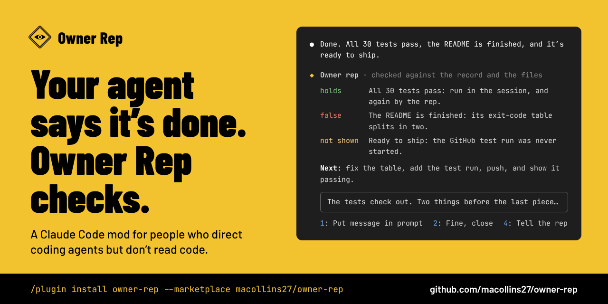

# Owner Rep

**Your coding agent says it's done. Owner Rep checks.**

[](https://github.com/macollins27/owner-rep/actions/workflows/tests.yml)
[](https://github.com/macollins27/owner-rep/releases)
[](LICENSE)
[](#install)



Owner Rep is a Claude Code mod that watches your coding agent on your behalf. It tells you in
plain English what is really finished, what got left out, and exactly what to say to the
agent next. It is built for people who direct AI coding agents but don't read code: founders,
vibe coders, product people, anyone who has had to take an agent's word for it.

Install it from the Claude Code prompt:

```
/plugin install owner-rep --marketplace macollins27/owner-rep
```

Press `y` to add the marketplace, pick a scope, and the rep appears above your prompt.
[Other ways to install](#install).

- **What it is:** a Claude Code mod (a plugin with a hooks module) that supervises your
  coding agent and reports in plain English.
- **What it needs:** Claude Code 2.1.310, the build its tests run on. It runs on macOS, Linux
  and Windows; the independent check doesn't run on Windows.
- **What it costs:** it uses your own Claude Code account. The light reads run on their own;
  the heavy check runs only when you press for it.
- **What it sends:** only its own model calls, made with your Claude Code session's
  credentials. No servers, no telemetry, no dependencies. MIT licence.

## Why you'd want one

On a building site, an owner who can't read blueprints hires an **owner's rep**. The rep is on
the owner's side of the table, walks the site, checks the contractor's work against what was
agreed, and reports back in plain words.

If you build software by directing AI agents, you have the same problem. The agent's own
report is the only account you get, and it is the one account you can't take on trust. Agents
say "done" when the tests never ran. They quietly shrink the job to the part they finished.
They take the easy option in place of the right one. They leave a chore "for you" and call
the work complete.

Owner Rep reads the same conversation the agent works from, takes nothing on the agent's
word, and tells you what is really going on.

## What it does

**A row above your prompt, always there.** It shows the result you want, in the rep's own
words, worked out from your messages, and what the agent is doing right now. A mark appears
when the session needs you: the agent has stopped, is asking a question, or has a plan
waiting for your yes.

**A "Heads up" when something costs you.** While the agent works, the rep takes a quiet look
every eighth model request and at every stop. It stays silent unless it finds something with
a cost to you: work dropped or shrunk, a claim not shown, a test never run, or the easy
option taken in place of the right one. Then one "Heads up" line appears above the row.

**A briefing when you press `1`.** The card says where the work really stands, what the
agent's last message means, what was left out, and what should happen next. It also gives you
the message to send the agent, written and ready. One press puts that message in your prompt
box. Nothing is sent until you press Enter.

**An independent check when you press `3`.** A separate Claude Code run works in a throwaway
copy of your project. It reads the session's full record, opens the real files and runs your
project's own tests. Then it marks each of the agent's claims **holds**, **false**, **not
shown**, or **since then** (changed since the briefing).

## What it looks like

These are from a real session. The agent had written a README and stopped, as it was told
to. The briefing found what was still missing. The automatic test run on GitHub had never
been started, a table in the README would render broken, nothing had been pushed, and the
README promised "Python 3.9 or newer" when only 3.9 had been tested.


After **Check it**, a separate run went through the agent's claims against the session record
and the files. Nine held. One could not be shown from where the check could reach, and the
card says why.


## Install

You need Claude Code with mods turned on, which is the default. The mod is tested on Claude
Code 2.1.310. Run `claude --version` to see yours, and update if it's older.

At the Claude Code prompt:

```
/plugin install owner-rep --marketplace macollins27/owner-rep
```

From your shell:

```
claude plugin install owner-rep --marketplace macollins27/owner-rep
```

Or in two steps, which works on any build with plugin marketplaces:

```
claude plugin marketplace add macollins27/owner-rep
claude plugin install owner-rep@owner-rep
```

A shell install takes effect in your next session, or after `/reload-plugins` in one that is
already open. To update later, run `claude plugin update owner-rep@owner-rep` and restart.
To remove it, run `claude plugin uninstall owner-rep@owner-rep`.

**Where it draws.** The rep draws in the terminal, in the Claude desktop app, and in Claude
Code for VS Code's chat window from extension 2.1.310.

**On Windows**, the row, the watch and the briefing all work, with Git for Windows
installed: the rep reads your messages through its commands. **Check it** does not run,
because Claude Code's sandbox is off on Windows and the rep will not run the check without
it. The card says so in place of the button.

**On Linux**, the check needs Claude Code's sandbox. Where the sandbox can't start (for
example, without bubblewrap), the first press of **Check it** is refused and the card names
what is missing. The button then stays off until you restart Claude Code.

**Optional:** with [agentsview](https://github.com/wesm/agentsview) on your path, the check
reads the session's record through it. Without agentsview, the check reads the session's
transcript file under `~/.claude/projects/`.

## Using it

Work the way you normally do. The rep keeps its row above the prompt. Press a digit from the
prompt box, or click.

| When you see | Press | What happens |
|---|---|---|
| The row | `1` Brief me | The briefing card opens |
| The row | `2` Tell the rep | `Owner rep:` goes into your prompt box, ready for a note |
| A Heads up | `1` Brief me | The briefing card opens |
| A Heads up | `2` Fine or `0` Later | The note is dismissed |
| The briefing card | `1` Put message in prompt | The rep's message to the agent goes into your prompt box. Press Enter to send it |
| The briefing card | `3` Check it | The independent check runs. It costs more, so it runs only when you ask |
| The briefing card | `4` Tell the rep | `Owner rep:` goes into your prompt box, ready for a note |
| The briefing card | `2` Fine, close or `0` Later | The card closes |

**Talking to the rep.** Start a prompt with `Owner rep:` to talk to the rep instead of the
agent, for example `Owner rep: the tests matter more than the README`. The rep takes the
note, updates its account of what you want, and looks again at once. The agent never sees
the note.

**Sharing the strip.** The row shares its space above the prompt with other mods. While
another mod's note is up, the rep's note waits, so only one set of digit keys is on screen
at a time.

## How it judges

The rep keeps its own account of what you want on the job in hand. It holds four parts: the
result, what it is for, what "done" has to show, and the step the session is on now. It
works this out from all your messages on the job, not just the latest one, so a message that
narrows the agent's next step can't shrink the whole job.

It weighs your messages by kind. A note you send to the rep counts most of all. Then come
your reasons and complaints, then your instructions. A "yes" to the agent's own idea counts
least, because that is the agent's idea with your name on it.

On top of that it holds five expectations for every job:

- the whole result is delivered;
- it is shown to work, not just said to work;
- no known problem is left behind;
- nothing was added that the result doesn't need;
- it was done the way that is best for the result, not the way that was easiest for the agent.

You do no step of the job yourself. A chore the agent leaves "for you" is unfinished work,
and the rep puts it in the message to the agent.

Only your own messages can give the rep orders. Anything the agent wrote is treated as a
claim to be checked, even text you pasted in yourself. While any part of "done" is still
open, the rep will not tell the agent to stop or call the work finished.

The full method, with every rule and the reason for it, is in
[How the owner rep works](docs/how-it-works.md).

## What it costs

The rep's model calls are its own, on top of your agent's, and they run on the same Claude
account as your session.

| Part | When it runs | What it costs |
|---|---|---|
| The rep's account of your job | Each message you send, and each note to the rep | One call to Opus at high effort, over your messages only, not the whole conversation. A failed write is tried up to twice more |
| The watch | Every eighth model request of a turn, and at every stop | A fresh look over the agent's cached conversation. Mostly cache reads, and it never slows the agent |
| The briefing | When you press for it | One model call, sometimes two or three when the rep has to rewrite an answer |
| The check | Only when you press **Check it** | Measured at about 210k fresh tokens plus 2.25 million re-read from cache, in about two minutes |

The briefing card shows what the rep has spent so far in the session. Beside **Check it** it
shows what a check costs: the first one measured, then your own last one.

## What it can reach

The rep never sends anything to your agent by itself. You press Enter.

It never edits your project. The check works in a throwaway copy inside Claude Code's own
sandbox. Writes are denied to your real project, the git repositories it belongs to or links
into, Claude Code's settings, and the main places in your home folder that run code. The
sandbox closes the network to the check's commands, except for your own machine, where
agentsview answers. Reads are not fenced: like any agent, the check can read any file you can
read, and what it reads goes to the model. The copy is deleted when the check ends.

Nothing leaves your machine except the rep's own model calls, made with your Claude Code
session's credentials and sent where your agent's calls go. The mod has no servers, no
telemetry and no dependencies. Its source is two TypeScript files,
[`hooks/register.tsx`](hooks/register.tsx) and [`hooks/rep.ts`](hooks/rep.ts), with no build
step, so you can read exactly what runs.

Like every Claude Code mod, it runs with the permissions of the person who installs it. In
full, this is everything it reads and runs:

- **Through Claude Code:** the prompt box, the session id and working directory, the
  session's messages, and the agent's tool calls and helper launches as they happen. The row
  names a file or a program, never a command's text. It also reads the agent's last answer at
  the end of each turn, the context window's size, what other mods draw in the strip above
  the prompt, and a small per-session store. It calls the model with the session's own
  credentials, and takes the transcript path Claude Code gives its hooks.
- **Environment variables:** `PATH`, `HOME`, `USERPROFILE`, `CLAUDE_CONFIG_DIR`, `OS`,
  `SystemRoot`, `windir`, `PROGRAMFILES`, `ProgramFiles(x86)`, `LOCALAPPDATA` and `APPDATA`.
  It reads them to find your home, Claude Code's folder and the programs it runs, and to tell
  whether it is on Windows.
- **Your transcripts:** it runs `sed`, `grep`, `ls` and `find` over the session's transcript
  under `~/.claude/projects/` (or the folder `CLAUDE_CONFIG_DIR` names) to read which
  messages you typed. For a session it holds no record of, such as a fork, it may read up to
  40 of the newest other transcripts in the same project folder to find your earlier
  messages.
- **On Windows:** those commands are Git for Windows' own, named by their full path. The rep
  finds them, and Claude Code's own `claude.exe`, by running each place they may be with
  `--version`.
- **Only when you press Check it:** it runs `sh`, `find`, `printf`, `readlink` and `sed` to
  find the git repositories your project belongs to or links into and where links lead, so
  it can fence them. It runs `pnpm store path` to find pnpm's store, which the check is given
  to install from. It runs `mkdir`, `cp` and `rm` to make the throwaway copy and delete it
  afterwards.
- **The check itself:** a separate `claude -p` run that may read files, search, run the
  project's own tests and read agentsview. It may not edit through a tool, send, fetch the
  web, or launch helpers. It runs with your own Claude Code settings, so your hooks fire
  inside it as they do for any agent.
- **What it keeps:** one record per session, for the 32 newest sessions that hold anything.
  [PRIVACY.md](PRIVACY.md) lists what a record holds.

Mods are code that runs inside Claude Code with the access Claude Code has, so read the
source before installing any mod, this one included.

## Built to be trusted

- **230 tests**, run on Ubuntu, macOS and Windows on every push that touches the code or
  the tests.
- **A doctor that plants bugs.** It plants 306 known defects in a throwaway copy, one at a
  time, and fails the build if the tests miss any of them.
- **Real sessions.** Eleven scenarios run in real Claude Code sessions, with the screen
  captured in [`tests/live/captures`](tests/live/captures).
- **Proven by hand.** Each part was pressed live by its owner before the next was built.
- **Readable.** No dependencies, no build step, no minified code.

The testing design is in [`docs/testing.md`](docs/testing.md).

## Questions

**Do I need to know how to code?**
No. That is who it's for. The rep writes to you in plain English and writes the message to
the agent for you.

**Will it slow my agent down?**
No. The watch reads a cached copy of the conversation beside the agent and is never waited
on. There is one short wait. In a session the rep holds no record of, such as one started
before you installed it, your first prompt waits while the rep reads your earlier messages
from the transcripts.

**Can the agent talk the rep out of it?**
Only your own messages can steer the rep. The agent's words, including its summaries of its
own work, are claims the rep checks.

**Does it change my files?**
No. The rep never edits your project, and the check works in a throwaway copy inside Claude
Code's sandbox.

**Does it work with other mods?**
Yes. It shares the strip above the prompt and waits its turn while another mod's note is up.

**Is this made by Anthropic?**
No. Owner Rep is an independent, open-source mod by Maxwell Collins. Claude and Claude Code
are Anthropic's products.

**It stopped drawing after a Claude Code update.**
The mods API is early access and can change between releases. Update the mod with
`claude plugin update owner-rep@owner-rep` and restart. If it's still broken,
[open an issue](https://github.com/macollins27/owner-rep/issues/new/choose) with the output of
`claude --version`.

## How it was built

Owner Rep was built the way its users work: by directing Claude Code agents from a written
objective, with every part proven on screen before the next was started. The first version
was installed and working on 13 October 2026, the day it was started. It is installed in the
sessions that work on it, so it watches its own development.

## Contributing

Bug reports, ideas and pull requests are welcome. Read [CONTRIBUTING.md](CONTRIBUTING.md)
first. For a security problem, follow [SECURITY.md](SECURITY.md) and don't open a public
issue.

Thanks to Kyle Cunningham, who measured the Windows behaviour the rep relies on (#13), and to
the makers of [agentsview](https://github.com/wesm/agentsview), which the check reads.

## Licence

[MIT](LICENSE).
