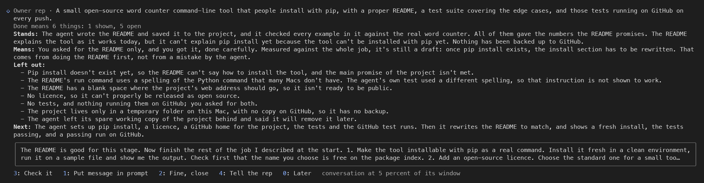
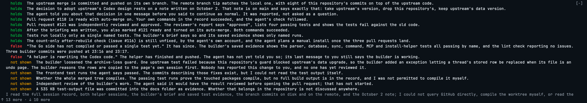

# Owner rep


A Claude Code mod that watches a coding agent on behalf of the person who owns the work,
and reports back in plain words: what the agent has really done, what it has left out, and
what to tell it next.

It is built for the owner who directs agents but does not read code. The agent's own report
is the only account they get, and it is the one account that cannot be taken on trust. The
rep reads the same conversation, takes nothing on the agent's word, and says so briefly.



## What it does

The rep draws one row above the prompt, in the same shape as Claude Code's built-in "You
should know" note: the result the owner wants, worked out from the owner's own messages, and
what the agent is doing right now, with a mark when the session needs a look (the agent has
stopped, is asking a question, or a plan is waiting for a yes). That status is plain words
built from the tool's name: a file's name for a read or an edit, the program's name for a
shell command, and never any text of the command itself.

Behind that row are three reads of increasing cost.

| Read | When | How | Cost |
|---|---|---|---|
| **Watch** | Every eighth model request of a turn, and at every stop | A fresh model instance over the agent's cached conversation, no tools | Mostly cache reads; never blocks the agent |
| **Briefing** | On a press (`1` or click) | Same mechanism, longer brief | One model call; two when its answer is refused and asked again (below) |
| **Check** | On a second press, only when chosen | A separate headless `claude -p` run in a throwaway copy of the project, fenced, over the session record and the real files | Measured at about 210k fresh tokens plus 2.2M cache reads, about two minutes |

The **watch** stays silent unless it finds something with a cost to the owner: work dropped
or shrunk, a claim not shown, a test never run, the easy option taken in place of the right
one. Then one "Heads up" line appears, with the reason beneath it.

The **briefing** is a card: where the work really stands, what the agent's last message means,
what was left out, what should happen next, and a message to the agent, written and ready. One
press puts that message in the prompt box. Nothing is sent until the owner presses Enter. The
card is folded to fit the rows the band has, body first and buttons never, so the digit that
closes it or puts its message in the prompt always reaches a button on screen. Rows are
counted as the band wraps them, at words, because a count by cells says one row too few for
a long paragraph and the card then scrolls with its buttons out of reach.

The **check** reads outside the conversation. It opens the session's full record through
agentsview, a local tool that indexes every coding-agent session on the machine, opens the files the agent claims to
have changed, runs the project's own tests, and rewrites the card with each claim marked
**holds**, **false**, **not shown**, or **changed since** the briefing was written. When the
band is short, the claims that hold fold to a count first and the ones that failed stay
listed, because the check is paid for to find what does not hold.



## How it decides

The rep measures against an objective: its own account, in its own words, of what the owner
wants on the job in hand. It is held in four parts: the result, what it is for, what "done"
has to show (a list of conditions), and the step the session is on now. It is never the
owner's text. The owner works by intent rather than exact wording, and a rep that only did
what the client literally said would not be a good one, so the objective includes what a
serious owner plainly wants without saying it. The owner's messages are weighed by kind:
reasons and complaints first, instructions next, and a "yes" to an agent's proposal last,
since that is the agent's idea with the owner's name on it.

The objective is written by a call of its own, never by the looks. Each message of the
owner's, and each note to the rep, starts one plain model call, not a fork of the
conversation, that is shown only the owner's numbered messages on the job (each kept whole
up to 6,000 characters, with the end of the agent's last words before it, so a short reply
can be understood), the objective as held, and the results of earlier jobs. The agent's
words reach the writer only as that line before each of the owner's messages, so they move
the objective only through what the owner answers, and the code keeps them from moving it any
other way: a write is taken only when it saw a message of the owner's past the ones the held
objective was built from, so a write that lands after a newer one is refused, and a message that arrives during
a write is written after it. A write that fails, comes back empty, or comes back in a shape
the code cannot read (which is what a reply cut off at its length limit looks like) leaves
the objective as it was and is counted, and the card's line of what the rep has spent names
the failed writes and, in plain words, the cause of the last. A failed attempt (an empty or
errored reply, an answer the code cannot read, or "holds" while no objective is held) is tried
again at the highest effort, up to twice (the empty replies it was measured on came from the
unfenced prompt, described below, and the retry stays as a net for an empty or unreadable
reply); a call that throws or is cut short is not tried again, nor is one once a newer
message of the owner's has arrived (the next pass writes over the fresh prompt), and a write
counts as failed only when every attempt did. When no objective is held yet, a press of Rep
writes one before the briefing.

A session is a run of jobs: the owner opens one, the agent works, the owner corrects it a
few times, the job ends and the next begins. A correction rebuilds the objective whole from
every message on the job, so the job is everything the owner has asked since it began, never
the latest message alone. A message that bounds the agent's next step cannot shrink the job:
every condition of "done" already held is kept unless the writer cites the number of a
message of the owner's that lets it go. A new job closes the old objective; its result is
listed to the model as closed, and the old job's messages leave what the writer and the
briefing are shown. The card shows when and why the objective last moved, and the row shows
the result.

Each condition is in one of four states: open; not shown, for a thing a conversation cannot
show by itself, such as whether a build is installed or a service runs the newest code;
shown; or closed by the owner. Open and not shown both count as open. The writer sees nothing of the conversation but the agent's last words before each of the owner's messages, marked as the agent's, so it can mark nothing shown: the code puts a condition it marks shown back to open unless it was already held so. The watch,
the briefing and the check mark a condition shown only by naming where the conversation or
the disk shows it, and closed only by citing a message of the owner's. When the check finds a
condition held shown is not so, it puts it back to not shown, and it stays not shown until a
later check shows it: a look or a briefing that marks it shown again moves nothing, the
writer never raises a condition's state, and the looks, the briefings and the writer are
shown what the check found beside it. The objective stays open until every condition is
shown or closed. While a condition is open, the gate refuses a briefing that says the agent
should stop, that gives no verdict, whose next step tells the agent to stop, to wrap up, to
stop and report, to wait for or await the owner or his word (with a stop or without), to stop
and ask him, to check in with him or let him decide, to hand the work back to him, or to wait
after a ", then", or calls the work finished or says the session or the agent can end it (a
step that only carries the word and goes on, such as stopping a wrong approach, waiting on a
CI run or on the agent's own build, a program that "runs once and stops", a step that says
not to wait for him, or an end put after a condition, is let through), or that says the work
is going well. Such a briefing is asked once more with
the open conditions named, and if it still does any of these the card is refused. While no
objective is written, any of the same is refused at once, and the card says the objective is
not written yet. A refused card lists the open conditions as left out, and its meaning, next
step and message are the rep's own, built from those conditions, so it keeps the agent on the
job and never offers a stop. The check passes the same gate.

These rules came from a session on 15 Oct 2026 in which a message that bounded the agent's
next step was read as the owner asking for less, the rep's account of the job shrank to the
latest message, and the rep called the session finished with the product it was opened for
not on the owner's screen. A first fix that locked the account's opening sentence was
replaced the same day by the objective in parts, its conditions and the gate, because the
lock held the result's wording and nothing else: what "done" had to show could still fall
away with a narrowing message, and nothing stopped a card from calling the job finished
while part of it was undone.

A message the rep drafted and the owner sent through "Put message in prompt" is recorded as
the rep's draft, never as the owner's words, and is recognised from the record after a
reload; whatever the owner typed after the draft is the owner's own message, numbered after
it. A draft moves only the step it asks for: it starts no write, and it never changes the
result, narrows the job, sets what "done" means or closes a condition.

The owner never types the objective. To steer the rep they type a prompt beginning
`Owner rep:`; the rep takes the note, drops the prompt before the agent sees it, lists it to
the model as said to the rep with the highest weight, rewrites the objective with it, and
reads again at once. The prefix also counts typed after a prompt to the agent, on a line of
its own, after a sentence's end (a closing quote or bracket included), or in its capitalised
form run straight onto a word or a sentence's end; the agent then gets the prompt without the
note, and the note goes to the rep alone, numbered after it. A mention inside a sentence, as
in "ask the owner rep: is it done", is not a note, and neither is the prefix inside a slash
command's arguments, which stay the command's. A prefix after text with nothing after it
notes nothing, and a toast says so.
"Tell the rep" puts the prefix in the prompt box.

On top of the objective sit five expectations the rep applies without reciting: the whole
result is delivered; it is shown to work, not said to work; no known problem is left behind;
nothing was added that the result does not need; and it was done the way that is best for the
result, not the way that was easiest for the agent. One consequence is spelled out in the
brief: the owner does no step of the job. A chore the agent leaves "for you", such as a branch
to delete, is the agent's unfinished work, listed as left out and put in the message to the
agent, never relayed to the owner as what to do next. A card that lists anything left out
cannot also carry the line saying every part is done; the code drops that line.

Nothing in a session except the owner's own messages can give the rep orders. Text an agent
wrote and the owner pasted is treated as an agent's claim. The full judging brief is in
[`hooks/rep.ts`](hooks/rep.ts).

## How it is built

Two modules, split on purpose.

- [`hooks/rep.ts`](hooks/rep.ts) holds everything that can be tested without an engine: the
  prompts for the watch, the briefing, the objective writer and the check, the parsers for
  the model's labelled answers, the objective's rules (how a correction keeps the conditions
  held, how a stop is refused while one is open, how a draft is told from the owner's own
  words), the check run's argument list and tool allowlist, and the cost arithmetic. It has
  no engine calls.
- [`hooks/register.tsx`](hooks/register.tsx) is the engine side: hook registrations, state
  atoms, the per-session store record, the band render, and the spawn of the check run.
- [`types/index.d.ts`](types/index.d.ts) declares the mod's state keys and the shapes the
  render reads.

The watch and the briefing use `$.model.fork`, the same mechanism as Claude Code's built-in
"You should know" note: a fresh instance of the model over the agent's prompt-cached
conversation, so a read costs little and never slows the agent. The rep's independence comes
from its brief, which tells the model to treat everything the agent wrote as a claim, and,
for the check step, from reading outside the conversation altogether. The objective writer is
the exception to the fork: a plain completion (`$.model.complete`) shown the agent's words
only as the line before each of the owner's messages, marked as the agent's. Its rules go to
it as its system prompt, and the owner's messages reach it fenced as quoted records that it is
told are no instruction to it, because unfenced, a message that read like a command came back
empty in all six tries measured on one such message (16 Oct 2026). Its brief also says that
line is there only so a short reply can be understood and never sets the result, and
the code takes a write only when it saw a message of the owner's past the ones the objective
was built from, so the agent's words alone never move it.

A fork has nothing to fork before the first response of the process: in a session reopened
with `--continue` or `--resume`, after `/clear`, and through the whole first turn of a new
session. A read the owner started, a press of the Rep button or the look after a note, then
reads the session's own record (`$.session.messages()`) instead: one plain completion, given
the record as entries labelled `entry 1`, `entry 2` and so on (never `#1`, the form the
owner's numbered messages take, so no entry can be cited as one of his) fenced as data
(each message cut to 3,000 characters, each tool's input and result to 600, the oldest
entries left out past 200,000 characters, with a line saying how many), a system prompt
saying the task means that record wherever it speaks of the conversation, and then the same
task the fork would have had. Only the rows that are one of his messages in the session's
transcript file are labelled as the person's; when no transcript can be read, every row on his side that is not
a kind Claude Code is known to write there. The watch's own looks, on a step and at a turn's end, skip quietly
instead, so a new session's first turn pays for no record read. With no record to read, as
after `/clear`, the briefing says there is nothing to read yet.

The check step runs in a room, not under a list of allowed commands. The rep first makes a
throwaway copy of the project as it stands, uncommitted work included (an APFS clone, made in
a moment and taking no space until written to), and spawns `claude -p` in it with
`--output-format json`, a turn limit and a fifteen-minute timeout. Inside the copy nothing
needs approval: the shell, the file tools and the agentsview tools are allowed outright, and
the only tool-level denials are the ones that edit through a tool, send, fetch the web or
launch helpers. The fence is Claude Code's built-in sandbox, passed as settings for that run:
writes are denied to the owner's work (the real project folder, `~/Developer`, `~/Documents`,
`~/work`) and to the files Claude Code reads its own configuration from, and the network is
closed except for this Mac, where agentsview answers. The owner's own guard hooks fire inside
the run as they do for every agent. The copy is removed when the run ends. The run's answer
carries the count of refused commands; the card shows it, and the right number is zero,
because a refusal in a room where nothing needs approval means the room has a hole. All of
this was measured on this build before it was built: bypassing approvals switches the
sandbox off, so the run does not bypass them; `denyWrite` beats `allowWrite`; and a
prefix allowlist, the earlier design, refused every compound command and cost a turn each
time, which is why checks ran out of time.
A newer press makes an older run's answer stale, and the card is only rewritten by the run
that belongs to it.

State is in two places. Atoms hold the per-session UI state that drives the render. The
plugin store holds one record per session, capped at the 32 newest: the objective with its
earlier versions and when and why it last moved, the results of earlier jobs, the owner's
messages, notes to the rep and sent drafts, each numbered (the job's kept whole up to 200,
and the 40 before it), flags already shown, notes other mods have shown, and spend counters
that count the writer's calls beside the looks. A record the cap lets go leaves the rep's
drafts it held in a separate list of the 200 newest, so a message the rep drafted stays its
own after the session that drew it drops out. A record saved by a build from before the
objective is rebuilt from the owner's messages on the next start, press or message, with its
old text kept as an earlier version. A session the rep holds no record of (one whose record
was dropped from the 32, one forked with a new id, one older than the mod) has the owner's
messages read back at its start and on a press from the session's transcript file under
`~/.claude/projects/`, in the file's order: only a line there with a human origin that is not
marked meta counts (a user line, or the queued-command line Claude Code saves for a message
typed while the agent works, which is never one of the session's rows at all). Each message
gets the end of the agent's words before it from the session's rows; a queued message, or
one whose row is gone (from before a compaction), gets none. After a compaction the rows hold
only the conversation's tail, so his messages are lined up with them from the end: a short
reply he sent both before and after it gets its prior only at its later place. The file is the one Claude Code
names to the mod's hooks, or, when none was named, the one found by the session's id; it is
read with `sed`, picture data blanked so the read stays under the output cap, and a read cut
at that cap counts as no read. A session forked with a new id has no file of its own until
its first message is saved, so the newest transcripts in that file's folder are read, at
most 40 within 30 seconds, and the one whose messages match the most of the fork's rows in
order (the newest on a tie) gives its part up to the last matched message, with the
messages queued right after it; the parent's later messages are never taken, and the scan
stops once a file matches every row that could be his. A session compacted after his last
message holds no row he typed, only the summary and the agent's work since; its own file is
read all the same, and a fork of it, with nothing typed to match, takes as its parent the
newest file in the folder that holds its last tool result, and his messages before that
result. Within a file the rows are lined up
from the end, and where they fit more than one place, the place with the fewest of his
messages left between the matched ones, then the latest, is taken, so a fork of a compacted
parent keeps every message up to the fork. A scan in which no file matched any row proves
nothing, and nothing is seeded from it. A row the transcript does not hold as his (task
notifications, another session's message, the summary of a compacted conversation) is never
taken as his, and when no transcript can be read nothing is seeded.
A message the rep drafted that he sent in any session the rep holds, the one forked from
included, is recognised as the rep's draft, and so is one a record holds among his messages
as a draft, so a card more than three back, or one sent under a build that kept no list of
drafts, is not taken as his, nor is one from a session whose record the store has let go. A prompt or a note he sends while that read is
still running waits for it, so his earlier messages are numbered first. A record that
already holds a message of his is never seeded. When the first objective written for a
seeded session says a new job opened at a later message of his, the job starts there, so a
fork of a session that had finished one job is not judged against that job's messages. Nothing leaves the machine except the model calls the session already makes.

The band above the prompt is a strip shared with other mods. The rep draws first and keeps
whatever is beneath it. While another mod's note is up, the rep's own note waits and its
buttons lose their digit hotkeys, so only one set of digits is ever on screen. From the
prompt box only a bare digit presses a band button, which is why every button carries one.

## Install

```
claude plugin marketplace add macollins27/owner-rep
claude plugin install owner-rep@owner-rep
```

Or from a local clone, with the folder's path in place of the GitHub name. Installed from a
folder, the mod runs from that folder: an edit reaches a session after `/reload-plugins` or a
restart. The check step reads the session record through `agentsview` when it is on the path, and
from the session's transcript file under `~/.claude/projects/` when it is not.

## Develop

```
claude plugin validate .      # manifest, hooks, and every engine call and state key
claude plugin test .          # 154 tests in tests/rep.test.tsx, a few seconds
python3 tests/doctor/doctor.py  # plants each known defect in a throwaway copy; the suite must fail
tests/live/live.sh              # on demand: nine real sessions in tmux, the strip captured to tests/live/captures
```

GitHub runs the validation, the tests, the type check and the doctor on every push
(`.github/workflows/tests.yml`); the type check there uses a pinned copy of the API
declarations in `tests/ci/`, and a step before it fails the run when the Claude Code build
the workflow installed is not the build that wrote that copy, so a change in the API can
never hide behind a type check against a stale copy.

```
tsc -p . --noEmit             # needs .claude-plugin/types/, see below
```

The tests cover the parsers, the row on both surfaces, the shared strip, the press, the
objective writer and its rules (the guard, corrections, new jobs, drafts, the marks and the
gate), the note to the rep, the stop forms the gate reads, the record read where there is
nothing to fork, the seeding of his messages from a stubbed transcript, and a press
followed by a check on a stubbed run. The test kit stubs the model and the
band; no test spawns a real check.

Type-checking needs the mods API declarations, which Claude Code writes into a mod's
development copy under `~/.claude/dev-mods/` when it sets one up, not into this repository.
Copy that `.claude-plugin/types/` folder here (it is git-ignored) and `tsc` runs clean. The
declarations are the authority on the API, which is early access and changes between
releases.

Validation reports one expected warning: a `CLAUDE.md` at the plugin root is not shipped as
plugin context. It is there for people and agents working on this repository, not for users
of the mod.

## What it can reach

Like every Claude Code mod, it runs with the permissions of the person who installs it. Its
own calls read the prompt box, the session id and working directory, the session's
messages, a small per-session store, and the model through the session's own credentials,
take the transcript path Claude Code gives its hooks at the session's start and with each
prompt, and run `sed`, `ls` and `find` over the session's transcripts under
`~/.claude/projects/` (or the folder `CLAUDE_CONFIG_DIR` names) to read which messages the
person typed. The check step
starts a separate Claude Code run that may read files, search, run the project's own tests
and read agentsview; it may not edit, send, or launch helpers. The rep never sends anything
to an agent by itself.

## Decisions along the way

- **Build on a mechanism that already works.** The built-in note's cached-fork read is cheap
  and proven; the rep reuses it with a different brief rather than adding a side channel.
- **No side panel.** A clean row that is always there beats a panel that must be opened, and
  it has to share the strip politely with the mods already using it.
- **Digits, not letters.** The first version used letter hotkeys; the first live press showed
  that only digits reach a band button from the prompt box.
- **The objective is the rep's, and the owner talks to the rep through the prompt box.** No
  field to click into and no sentence for the owner to compose: a note typed behind a prefix
  in their own prompt is intercepted by the rep, and the rep rewrites its own objective. A
  first version let the owner pin a sentence word for word; it was removed on 14 Oct 2026,
  because a rep that only holds the builder to the client's literal words is not doing the
  job.
- **The objective has a writer of its own.** The looks once rewrote the rep's account of the
  job from the conversation, where the agent's words sit beside the owner's. A separate call
  shown the owner's messages, and of the agent's words only the last ones before each of
  them, marked as the agent's and never setting the result, reads the job from the owner
  rather than from the agent's account of it, and holding the account in parts lets the code
  keep each condition of "done" until it is shown or the owner lets it go.
- **The check costs real money, so it runs only when chosen.** The card states the last
  measured cost beside the button.
- **The check runs outside the session.** A headless, read-only run, so the agent never
  hears from the rep and the owner gets no permission prompts.
- **Proven on real sessions.** Each route was pressed live by the owner before the next was
  built: the row, the briefing, the watch, the note to the rep, and two real checks on the session
  that built it. A keyboard chord for the Rep button could not be proven and was removed.

## Status

Built on 13 October 2026 in one session, by directing a Claude Code agent from a written
objective to an installed tool, with every part proven on screen before the next was started.
Validated and tested on Claude Code 2.1.296, 2.1.299 and 2.1.300. The mods API is early access;
expect the declarations, and this mod with them, to move.

## Licence

[MIT](LICENSE).
